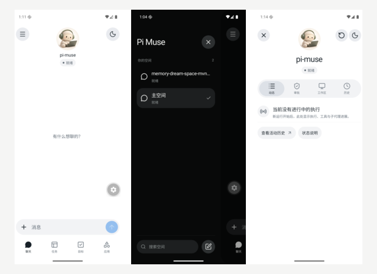
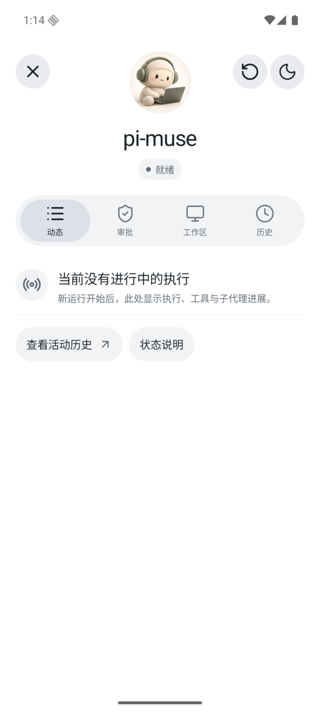

# Pi Muse

**一个客户端优先的开源 personal agent。**

部署自己的服务端，在手机 App 里聊天、安排任务、查看进度、确认文件修改。

[开始使用](#开始使用) · [界面](#界面) · [功能](#功能) · [未来](#接下来) · [Android 下载](https://github.com/yaotutu/pi-muse-mobile/releases)

## 界面

我喜欢 Muse 的 UI，所以基于 [pi](https://github.com/earendil-works/pi) 重新开发了 Pi Muse 的服务端和手机客户端。界面与交互借鉴 Muse。

Pi Muse 是客户端优先的项目。独立客户端可以承载更多信息，也能设计更完整的交互；接进飞书、QQ、微信这类聊天工具时，交互通常只有消息、命令和简单卡片。任务、目标、审批这些内容值得有各自的页面，而不是都塞进聊天记录。

## 功能

- **聊天与空间**：流式回复，按工作、生活、学习建立不同空间，分别保存对话和规则。
- **运行与活动**：查看 Agent 正在做什么、工具调用和已登记工作的进度，需要时可以停止。
- **任务与监控**：通过聊天创建一次性或每日任务，监控网页变化和关键词。
- **目标与里程碑**：记录长期目标，拆分并勾选里程碑。
- **文件修改与审批**：Agent 修改授权目录里的文件时，先展示完整改动，由你批准后执行。
- **记忆**：保存偏好和重要信息，需要时检索，也可以启用后台整理。

  

  运行状态与会话面板

目前主要维护 Android 客户端，iOS 还在规划中。提醒结果在 App 内查看，还没有锁屏推送。工具结果的专用展示也还在完善，目前主要使用文本和摘要。

## 接下来

### 带个人登录状态的浏览器

很多工作要先登录才能继续。只抓取公开网页，遇到登录页就拿不到内容，Agent 也就帮不上忙。

我希望 Pi Muse 能集成真正的浏览器：由你完成登录和授权，Agent 在允许的范围内使用这个会话，查看页面、整理信息、处理事情。这部分还没实现，目前只有网页搜索、抓取和监控。

### 接入更多设备和消息

服务端已经提供公开的 HTTP、SSE 接口。以后希望接入智能硬件、录音设备和其他平台的消息，也逐步接入手机上的短信、电话和邮件。具体能做到哪一步要看系统权限和平台限制，目前还没有这些连接器。

## 开始使用

1. 按[部署指南](docs/getting-started.md)安装服务端，配置模型接口和访问密钥。
2. 从 [Releases](https://github.com/yaotutu/pi-muse-mobile/releases) 下载 Android App。
3. 在 App 中填写服务端地址和访问密钥，连接后即可使用。

服务端需要 Node.js 24+、pnpm 12.10.1，以及兼容 OpenAI Chat Completions 协议的模型服务。模型调用可能产生费用。定时任务和网页监控需要服务端保持运行。

## 开源

服务端在本仓库，手机 App 在 [pi-muse-mobile](https://github.com/yaotutu/pi-muse-mobile)。服务端和客户端源码都开放，可以查看实现、提交问题或参与开发。

服务运行在哪里、接哪个模型、怎样保存会话和记忆，都由你自己配置和管理。普通用户只需要部署服务端、安装 App，不需要把几个仓库都研究一遍。

如果这个项目对你有帮助，欢迎点一个 Star。也欢迎通过 [Issues](https://github.com/yaotutu/pi-muse/issues) 告诉我你在用它做什么。

## 数据与安全

会话、记忆和工作区文件保存在你部署的服务端，目前按明文存储，请妥善保护实例目录和备份。使用外部模型时，处理请求所需的上下文仍会发送给模型服务商，自部署不等于本地推理。

请设置服务访问密钥；远程访问时使用 HTTPS 或安全组网，不要把未加密的 HTTP 服务直接暴露在公网。详细配置见[部署指南](docs/getting-started.md)和[配置说明](docs/configuration.md)。

## 文档

- [部署指南](docs/getting-started.md)
- [配置说明](docs/configuration.md)
- [开发与联调](docs/development.md)
- [架构规范](docs/architecture.md)
- [产品模块与资源文档](docs/product/README.md)

## 致谢

- [pi](https://github.com/earendil-works/pi)：Agent 执行与会话管理
- [nanobot](https://github.com/HKUDS/nanobot)：个人助手功能的设计参考
- Muse：界面与交互设计参考
