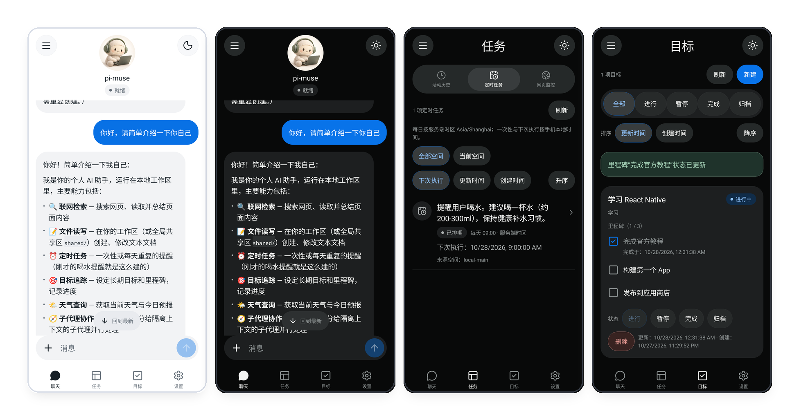
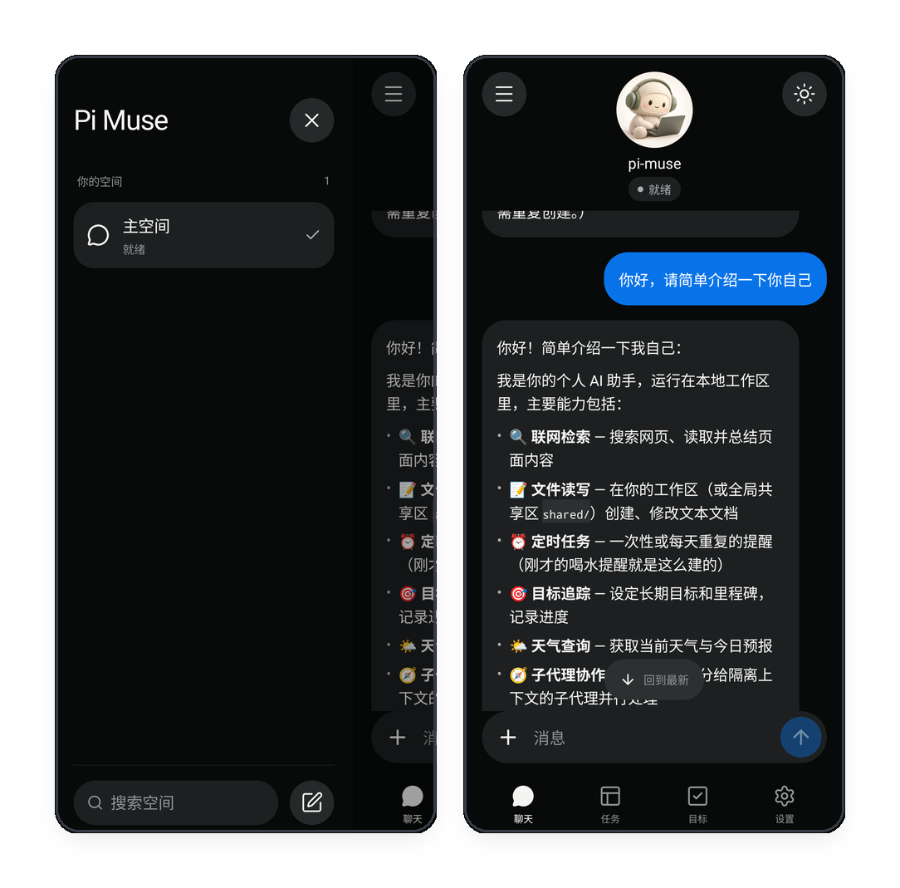
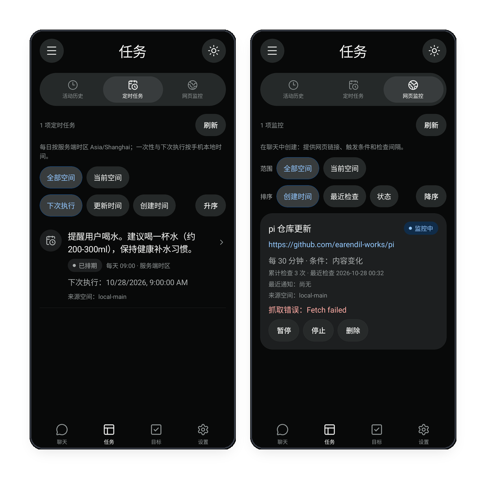
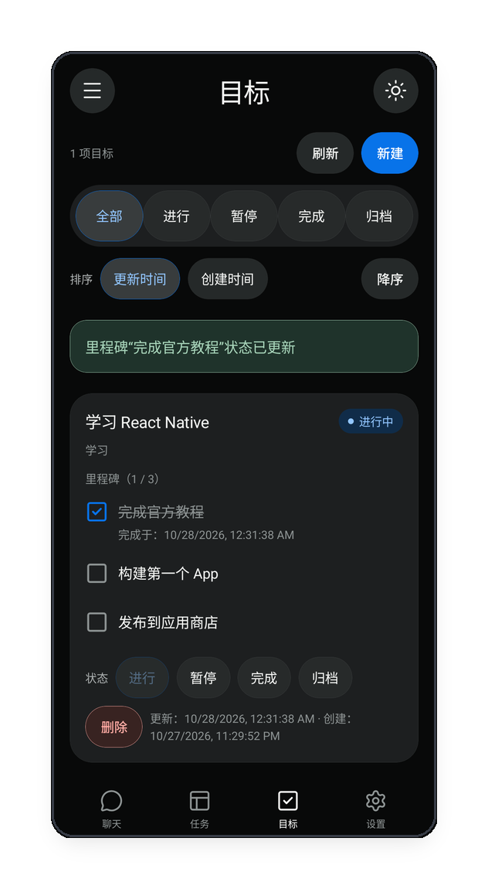
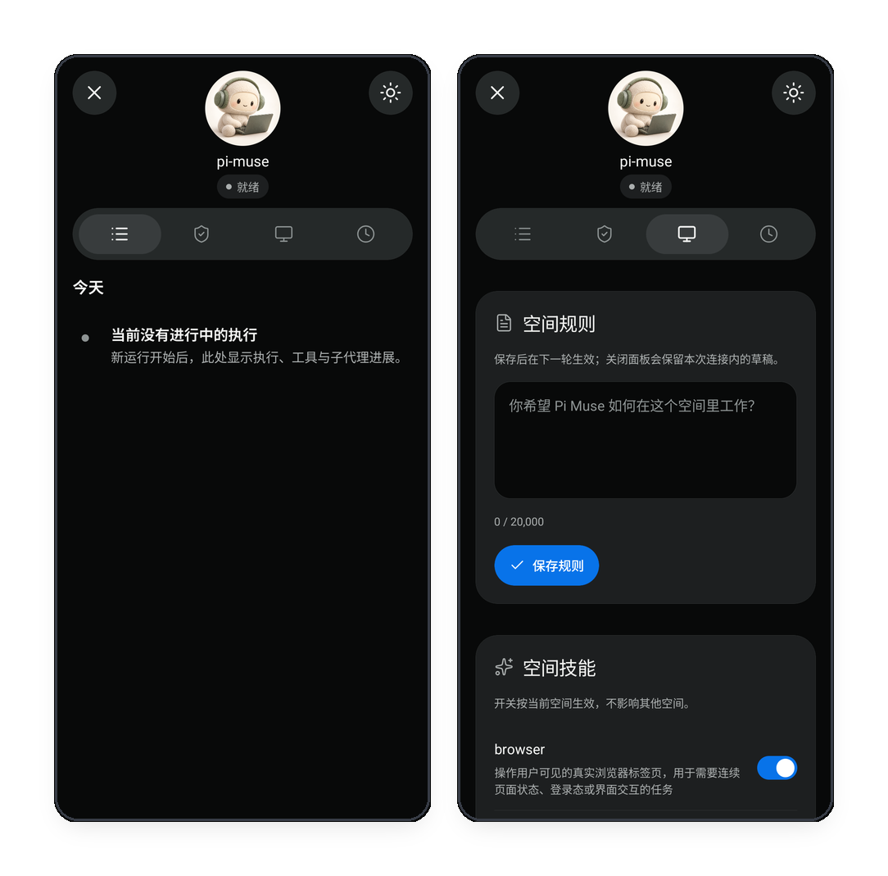
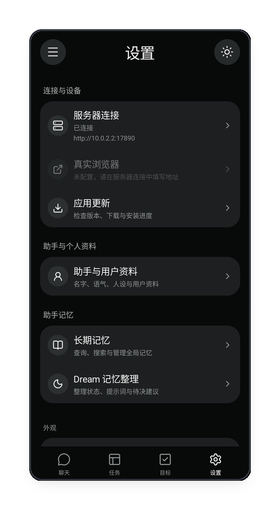

<div align="center">


# Pi Muse

[English](README.md) | [简体中文](README.zh-CN.md)

**基于 [pi](https://github.com/earendil-works/pi) 构建、客户端优先的开源 personal agent**

自部署你的 personal agent，通过公开 HTTP/SSE API 接入 Android、iOS、终端及其他平台。独立移动客户端将对话、任务、目标和审批集中在手边。

**[下载 Android APK](https://github.com/yaotutu/pi-muse-mobile/releases/latest/download/app-release.apk)** · [客户端仓库](https://github.com/yaotutu/pi-muse-mobile) · [版本说明](https://github.com/yaotutu/pi-muse-mobile/releases/latest)

部署服务端、安装客户端，再填写服务端地址和 AccessKey 即可连接，无需为自己的部署重新编译客户端。当前提供 Android 预编译安装包，其他平台可通过公开接口集成。

[快速开始](#快速开始) · [核心特性](#核心特性) · [为什么选择客户端优先](#为什么选择客户端优先) · [架构](#架构与通信协议) · [Android 下载](https://github.com/yaotutu/pi-muse-mobile/releases)

[](https://github.com/yaotutu/pi-muse/stargazers)
[](https://nodejs.org/)

<br/>

<p align="center">
  
</p>

</div>

---

## 为什么选择客户端优先？

许多个人智能体项目被放进既有聊天平台或一个简易 Web 聊天窗口。对一个需要持续处理个人事务的助手来说，这种交互很快会遇到限制：

1. **聊天记录不是控制台。** 对话流适合即时交流，但不适合管理周期任务、复盘子代理进度或查看长期计划里的里程碑。
2. **各能力有专属界面。** Pi Muse 为对话、空间、定时任务、网页监控、目标和审批提供独立页面与操作闭环，而不是把它们都埋在长长的聊天记录里。
3. **客户端本身就是产品。** 移动端提供清晰的导航结构、手势交互、动态虚拟形象，以及面向手机使用调校的浅色与深色主题。

---

## 核心特性

### 智能对话与多空间隔离

<p align="center">
  
</p>

- **流式对话与结构化渲染。** 对话通过 AG-UI SSE 执行，客户端渲染 Markdown、可复制代码块、多级列表和内嵌工具状态卡片。
- **持久消息反馈。** 已保存的用户和助手消息支持喜欢、不喜欢与评论。Pi Muse 独立保留反应变化、评论编辑前后及删除前的原文，不改写 PI 执行历史，不触发模型，也不自动修改用户偏好。
- **空间独立隔离。** 可创建工作、生活、学习等上下文。每个空间拥有独立对话树、空间指令和工具开关。
- **易用的空间侧栏。** 点击顶部菜单或使用边缘滑出手势打开，搜索并切换所有空间。

---

### 定时任务与网页监控

<p align="center">
  
</p>

- **自然语言排期。** 可约定一个显式时间的一次性提醒，或固定时间的每日任务。当前排期仅支持一次性和每日任务。
- **后台网页监控。** 提供公网页面 URL 与检测条件（如页面文本变动或命中关键词），服务端会后台巡检并在满足条件时提醒。
- **可视化任务状态。** 任务页展示下次运行时间、累计检查次数和最近错误，并支持单项刷新、暂停、停止或删除。

---

### 长期目标与里程碑

<p align="center">
  
</p>

- **把大目标拆成里程碑。** 与 Agent 讨论中长期目标，并将其整理为具体检查点。
- **交互式打卡进度。** 在手机上勾选完成里程碑，查看完成时间与 `1 / 3` 这类整体进度。
- **筛选与排序。** 支持全部、进行中、已暂停、已完成、归档视图，并可按更新时间或创建时间排序。

---

### 会话中心、空间规则与人工审批

<p align="center">
  
</p>

- **会话活动中心。** 从聊天页打开，查看当前 Agent 活动、工具调用和子代理协作。这里展示活动事件，不展示隐藏的模型推理。
- **明确的文件修改审批。** Agent 没有 Shell 工具。文件 `write` 和 `edit` 只能作用于当前工作区，每次操作都需要人工确认完整前后差异；过期或文件已变化的审批不能提交。
- **空间级规则与工具。** 为当前空间注入运行指令，并按空间开启或关闭浏览器等能力。

---

### 真实浏览器与 noVNC 接管

- **真实图形化 Chrome 环境。** Docker 部署提供完整 Linux Chrome 桌面，而不是 headless 浏览器。
- **需要时人工介入。** 在浏览器中打开 noVNC 画面，处理图形验证、复杂登录或需要人工作出的交互决定。

---

### 设置中心与个性化画像

<p align="center">
  
</p>

- **连接管理。** 配置局域网或远程服务端地址，使用服务端 AccessKey 认证。客户端只保存 Session Token，不持久化明文 AccessKey。
- **助手与用户画像。** 自定义助手称呼、语气，以及有用的个人偏好。
- **长期记忆与 Dream。** 检索沉淀记忆，并可选择开启 Dream 周期整理记忆和提出后续事项建议。

---

## 快速开始

### 1. 运行服务端

环境要求：

- Node.js `>= 24`
- pnpm `12.10.1`
- 任意兼容 OpenAI API 的模型服务

克隆公开仓库并安装依赖：

```sh
git clone https://github.com/yaotutu/pi-muse.git
cd pi-muse
pnpm install
```

创建必需的配置文件，收紧权限，并在启动前完成编辑：

```sh
mkdir -p .pi-muse
cp -n config.example.json .pi-muse/config.json
chmod 600 .pi-muse/config.json
```

至少在 `.pi-muse/config.json` 中设置 `server.accessKey`、`model.baseUrl`、`model.id` 和 `model.apiKey`。完整字段见[配置说明](docs/configuration.md)。

启动开发服务：

```sh
pnpm dev
```

API 默认监听 `17890` 端口。生产构建可使用 `pnpm build && pnpm start`。

#### 可选浏览器容器

浏览器容器是可选的替代部署，同时提供 noVNC：

```sh
docker compose -f compose.browser.yaml up --build -d
```

它的默认 API 端口同样是 `17890`，不能与同主机同端口的本地服务同时运行。应作为替代运行，或映射不同宿主端口。详见[浏览器 Docker 说明](docs/browser-docker.md)。

---

### 2. 连接 Android 客户端

1. [下载最新 Android APK](https://github.com/yaotutu/pi-muse-mobile/releases/latest/download/app-release.apk)。源码与平台说明见[客户端仓库](https://github.com/yaotutu/pi-muse-mobile)，已发布版本信息见[版本说明](https://github.com/yaotutu/pi-muse-mobile/releases/latest)。
2. 在 Android 手机或模拟器中安装并启动 App。
3. 进入 **设置 -> 服务器连接**，填写可访问的服务端地址（如 `http://192.168.1.100:17890` 或 `http://your-server.example:17890`）以及配置中的 `server.accessKey`。
4. 点击 **测试连接**，通过后再点击 **连接服务器** 保存已验证的连接；只测试成功不会自动保存。

直接支持 HTTP，不要求域名、证书或 HTTPS 反向代理。地址填写服务端根地址，不要附加 `/api` 或 `/docs`。真机上的 `localhost` 和 `127.0.0.1` 指向手机本身，不是服务端。服务端需要持续运行且端口可达。模型凭据只在服务端配置，客户端填写的是服务端 AccessKey，不是模型 API key。网络设置详见[快速上手](docs/getting-started.md#3-连接手机客户端)。

仓库内的 `web/` 是 HTTP/SSE 开发验证页面，不是主要产品客户端。

---

### 3. 接入其他平台

运行时的 `/docs` 和 `/openapi.json` 提供公开 REST 与 SSE 契约，可用于构建 iOS、终端或其他客户端，也可以将 Pi Muse 集成到你已有的工具中。

---

## 架构与通信协议

Pi Muse 使用 HTTP 发起请求和管理状态，并使用单向 SSE 流从服务端向客户端推送事件：

1. **Agent 执行流。** 聊天请求启动 AG-UI SSE 响应，将 Token、工具事件和结果更新从服务端推送给客户端。
2. **工作区通知流。** `/api/events` 是共享 SSE 流，用于状态更新、待审批文件操作和活动事件。
3. **REST 管理。** 空间、历史读取、记忆检索、任务、监控、目标、审批和其他控制使用公开的 HTTP 接口。

---

## 数据与隐私安全

- **自部署不等于离线。** 配置的模型提供方会收到当前任务所需的提示词和上下文。其他服务端数据留在你的部署中，但模型请求会离开该部署。
- **本地数据是明文。** 会话、画像、记忆、工作区文件、任务状态、签名密钥和配置凭据均以明文本地存储。请严格保护实例目录和备份权限。
- **设置 AccessKey，了解 HTTP 边界。** 设置强随机 `server.accessKey`。HTTP 正常受支持，但访问密钥、Token 和聊天内容没有传输加密，优先在可信网络中使用；HTTPS 或安全虚拟组网是远程访问的可选保护，不是连接前提。
- **工具权限保持收敛。** 没有 Shell 工具。Web 请求默认只允许公网 HTTP(S) 并带 SSRF 校验；文件写入限定在工作区内，并通过完整差异逐次人工审批。

---

## 文档

当前详细文档以中文编写。

- [快速上手](docs/getting-started.md)
- [配置说明](docs/configuration.md)
- [架构规范](docs/architecture.md)
- [真实浏览器 Docker 说明](docs/browser-docker.md)
- [开发与联调手册](docs/development.md)
- [HTTP API 契约](docs/http-api-contract.md)
- [虚拟形象素材说明](docs/avatar.md)
- [测试指南](docs/testing.md)

---

## 致谢

- [pi](https://github.com/earendil-works/pi)：Agent 执行与会话管理
- [nanobot](https://github.com/HKUDS/nanobot)：个人助手功能设计参考
- Muse：界面与交互设计参考
