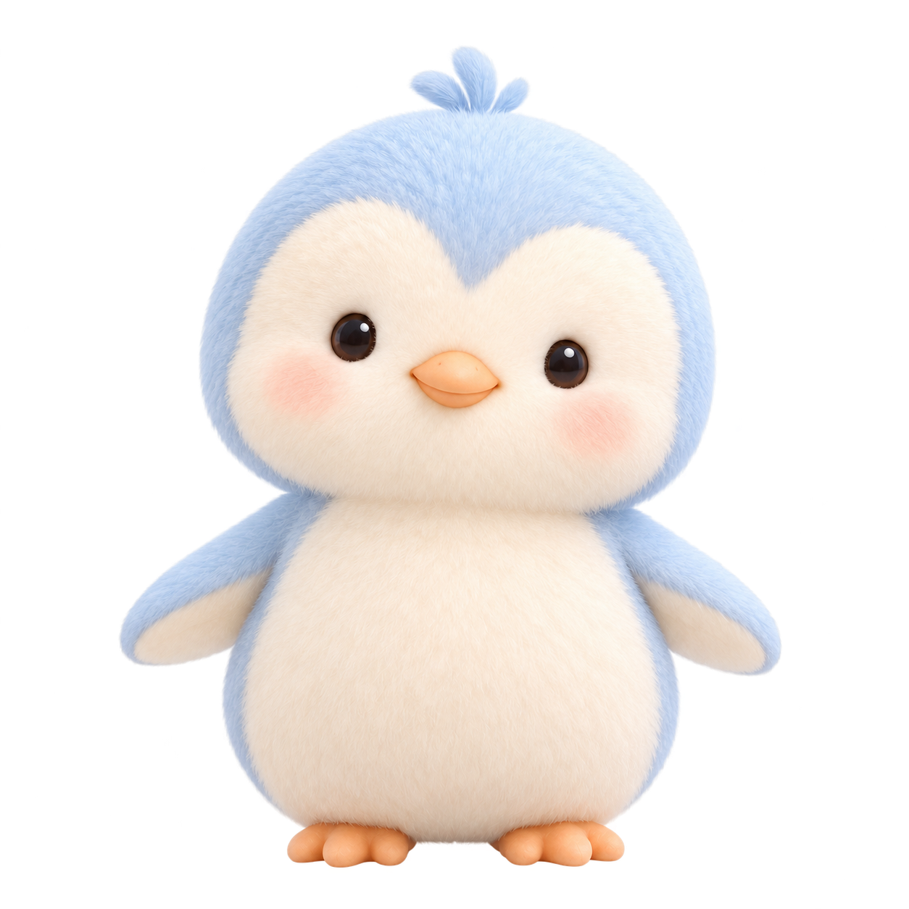

# idle 待机

[返回素材总览](../../../avatar.md)



- 中文动作名：待机。
- phase/status 依据：已同步且当前空间没有活动运行；不是额外枚举。
- 动作：自然呼吸、眨眼、轻微转头，脚保持站定。
- 输出比例：正方形 `1:1`，视频文件的像素宽高必须相等；不是横版或竖版。
- 播放方式：循环。
- 上传图片：`base.png`（本目录）。
- 已有视频：[idle-hailuo-768p.mp4](idle-hailuo-768p.mp4)。

## 来源与校验

- 来源图：`base.png`；task_id `456404912869691`；file_id `456405224571173`；SHA256 `ea55c4acb01a68238a94d7d7e356c6943ab7f360700438a82df86dc87e188c0f`。

## 视频提示词

用于重做或替换该动作视频；上传图片见上方说明。

```text
Required output format: a true square 1:1 video canvas with equal pixel width and height. The actual video file must be square, not a landscape 16:9 or portrait 9:16 video. Do not place square content inside a rectangular frame; no letterboxing, pillarboxing, black bars or borders. Compose directly for the square canvas and keep the entire penguin, crown tuft, feet and any laptop fully visible throughout the motion, with safe margins and no cropped limbs or props.

Use the uploaded image as the exact first frame and preserve this identity exactly: pale ice-blue head/back/flippers, cream face and belly, small dark glossy eyes, peach-orange beak and feet, crown tuft, fine soft down, light palette, proportions and camera framing. Keep a completely static eye-level camera: no pan, zoom, shake, cuts, reframing or whole-image pulsing. Move only the character with small coherent head, eyelid, flipper and body motion. Keep the background plain white, keep all limbs and props intact, and keep the full character inside the frame. No audio, speech, morphing, extra limbs, new clothing, text, logos, symbols or watermark. The standing penguin breathes subtly through its chest and shoulders, blinks naturally once, gently glances toward the viewer, and returns to the exact starting pose. Feet stay planted. Return naturally to the starting pose so the action can loop.
```
