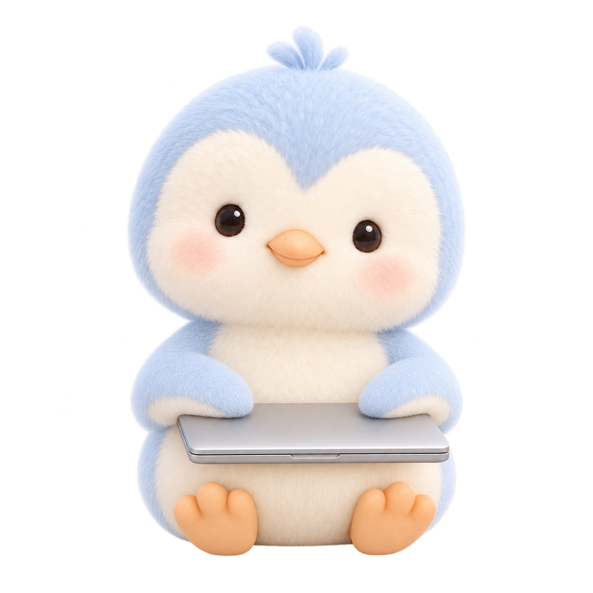

# stopped 停止

[返回素材总览](../../../avatar.md)



- 中文动作名：停止。
- phase/status 依据：`status=cancelled`。
- 动作：用户要求停止：离开键盘、合上电脑并平静看向用户；不是失败。
- 播放方式：单次后回待机。
- 上传图片：[起始工作姿势](../working/working.png)与[结束停止姿势](stopped.png)；前者来自 `../working/working.png`，后者是本目录的 `stopped.png`，不复制共用素材。
- 视频尚未生成；目标文件名 `stopped-gemini-v1.mp4`（本目录）。

## 视频提示词

用于生成该动作视频；上传图片见上方说明，下载后按目标文件名放回本目录。

```text
Use the uploaded image as the exact first frame and preserve this identity exactly: pale ice-blue head/back/flippers, cream face and belly, small dark glossy eyes, peach-orange beak and feet, crown tuft, fine soft down, light palette, proportions and camera framing. Keep a completely static eye-level camera: no pan, zoom, shake, cuts, reframing or whole-image pulsing. Move only the character with small coherent head, eyelid, flipper and body motion. Keep the background plain white, keep all limbs and props intact, and keep the full character inside the frame. No audio, speech, morphing, extra limbs, new clothing, text, logos, symbols or watermark. Create one calm user-requested stopping action, not a failure: the penguin lifts its flippers away from the keyboard, gently closes the laptop, and rests both flippers on the closed lid. End looking calmly at the viewer. End in the uploaded second image pose.
```
