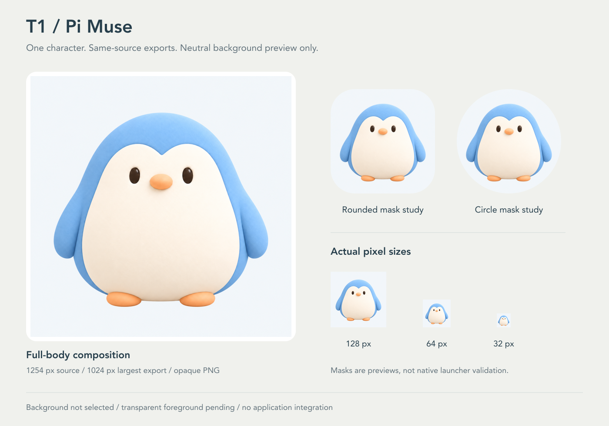
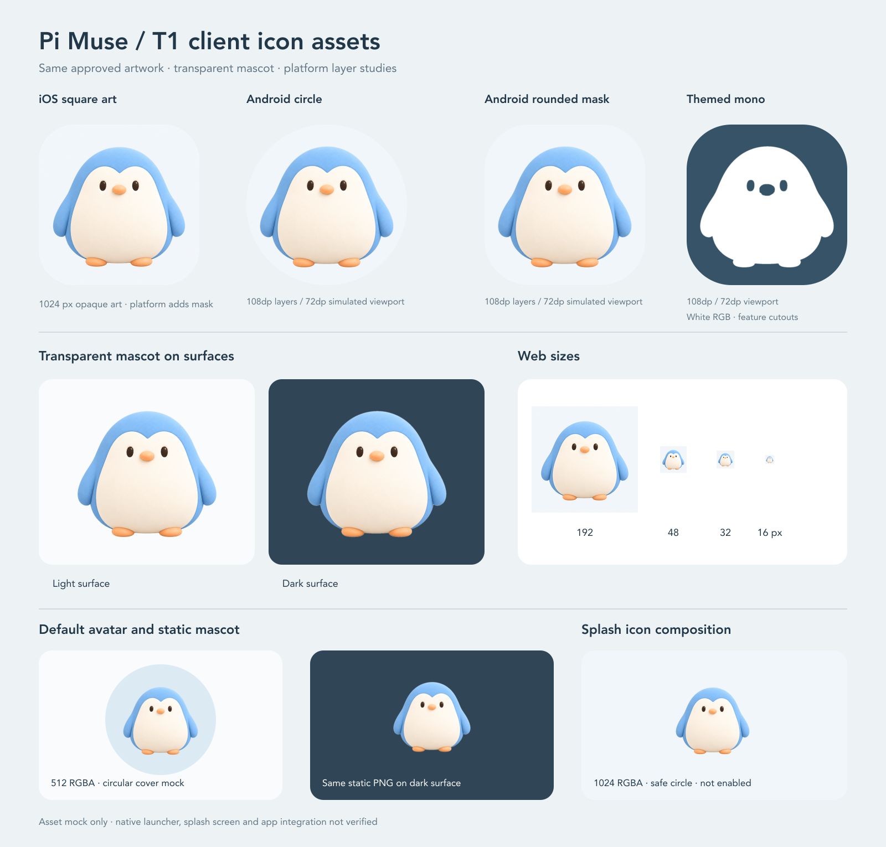

# Pi Muse 项目级品牌与吉祥物

这里是整个 Pi Muse 项目的形象资产源，不是服务端专属素材。文件暂随主仓库管理，因为工作区根目录不在 Git 中；不另建资源服务、npm 包或第三个仓库。

## 当前基准

用户选定的 T1 蓝白小企鹅是项目吉祥物，也是默认角色的视觉基准，供客户端、网站、README、文档、宣传图及后续动作和视频共同使用。T1 是设计稿编号，不是正式角色名字，也不是业务模型或人设配置。

- [neutral-icon-master.png](previews/neutral-icon-master.png)：用户已确认满意的当前完整视觉基准，1254 × 1254、不透明 RGB PNG。后续角色与图标派生默认使用这张蓝白企鹅、浅瓷白底的图片，不再重新选形象或背景；文件保留原路径，避免不必要的改名。
- [reference.png](mascot/reference.png)：早期独立形象来源，1254 × 1254、不透明 RGB PNG。从移动端已有独立图原样复制，保留选型和生成溯源。桃色背景已被用户拒绝，不再作为当前完整视觉基准。
- [selected-concept-board.png](mascot/selected-concept-board.png)：用户选型的原始对照图，仅左上角 T1 被选定。它保留最初选型证据，不是第二份可自行修改的母版。
- [manifest.json](manifest.json)：文件职责、尺寸、校验和及交付状态。校验和只用于识别来源，不引入运行时校验或同步框架。

独立形象基准是从选型稿生成的细化图，并非原始 T1 的逐像素放大；如需判断身份差异，回看原始选型图。早期透明草稿有彩色边缘与零散透明度像素，已被拒绝；本次 `mascot/transparent.png` 是从已确认浅底图稿确定性抠出的透明母版。透明图不是 3D、矢量或可编辑分层设计源文件。

## 已确认的图稿与派生素材

- [已确认浅底图稿](previews/neutral-icon-master.png)：由早期形象来源通过内置生图工具编辑得到，用户于 2026-10-29 确认满意。生成过程可能轻微改变细节，不称为逐像素抠图；后续从本张确认稿派生，不重新生图替换。
- `exports/neutral-icon-{size}.png`：1024、512、256、128、64、32 六种正方形 RGB PNG，全部从同一张确认稿缩放。可用于头像、文档和图标尺寸评估；没有预先烘焙圆角或圆形遮罩。
- [预览排版源](neutral-icon-sheet.svg)与[生成说明](generation-brief.txt)：保留实际提示词、缩放方式和已知限制，便于后续继续制作。

用户已认可图稿中的浅瓷白背景，以实际图片为准，不把生成提示中的色值当作经过测量的品牌色标准。历史预览中的圆角、圆形仅用于观察裁切效果，不是 iOS 或 Android 原生验收。

## 客户端静态素材与交接包

- [透明吉祥物](mascot/transparent.png)：1254 × 1254 RGBA，保留脸腹、短翅和双脚；从确认稿按颜色、连通区域与边缘平滑确定性抠图。透明母版可在浅色和深色表面复用。
- `client/icon.png`：1024 × 1024 RGB，不透明、无预烘焙圆角；作为 iOS 通用源图，不另存同内容副本。
- `client/android-icon-foreground.png`、`client/android-icon-background.png`、`client/android-icon-monochrome.png`：各 1024 × 1024；前景与单色层为 RGBA，背景为 RGB。单色层白色主体的 alpha 留出了眼睛与嘴部。前景和单色层的所有非零 alpha 像素均落在中央 66/108 直径安全圆内。
- `client/favicon.png`：48 × 48；`client/web/icon-{16,32,192,512}.png`：相应像素尺寸，均是不透明 RGB 图。
- `client/images/muse-companion.png`：512 × 512 真 RGBA 静态默认形象，从透明母版机械缩放并居中留白，可完整落入圆形头像遮罩；不包含动画状态。
- `client/splash-icon.png`：1024 × 1024 真 RGBA，与 Android 前景**字节相同**，复用其中央安全圆构图。供后续启动页接入；当前 `app.json` 尚未启用启动页插件。
- [移动端交接指南](client-handoff.md)和[便携 ZIP](delivery/pi-muse-client-assets.zip)：列出目标路径、实际引用状态与接入边界；ZIP 仅含正式 PNG、指南副本及包内校验和。
- [预览排版源](client-icon-sheet.svg)、[可复现脚本](build-client-icons.py)：预览模拟 iOS 圆角、Android 圆形和圆角遮罩、主题单色、多尺寸、透明形象、圆形头像和启动图构图。Android 预览将完整 108dp 图层放在居中的 72dp 可见视口后裁切；整张图都是 asset mock，不是原生验收。

在仓库根目录运行 `python3 docs/assets/brand/build-client-icons.py` 可重建本批 PNG、预览与 ZIP；需本机有 ImageMagick 7 和 librsvg 的 `rsvg-convert`。Python 只编排命令、复制相同字节的启动图及制作确定性 ZIP，像素操作均由 ImageMagick 完成。临时文件只在本目录创建并自动清理。脚本读取唯一已确认母版，不读取历史桃色来源，不调用生图服务，不修改原图。Android 纯色背景 `#F1F6FA` 是与图稿浅底协调的派生色，不替代原图背景或建立新的标准品牌色。

文件尺寸、模式、SHA-256 和静态安全区结果见 [manifest.json](manifest.json)。本批素材仅做静态检查与模拟预览，未在 iOS/Android 原生启动器或启动页中测试。

图层尺寸与安全区按 [Android adaptive icon 规范](https://developer.android.com/develop/ui/compose/system/icon_design_adaptive) 制作；PNG、iOS 源图和 Android 三层命名参考 [Expo 图标说明](https://docs.expo.dev/develop/user-interface/splash-screen-and-app-icon/)。

本批素材在独立 `brand-assets` worktree 维护，未改动应用配置，也未合入主分支或发布。后续由各消费端复制需要的派生文件并分别接入。

## 固定形象，分离用途

固定特征：饱满蛋形身体、粉蓝色外壳、连续的暖象牙白脸腹、额头中间浅凹、深色椭圆眼睛、橙杏色小嘴和小脚、两侧短翅，以及简洁柔软的哑光质感。不加毛绒头冠、腮红、衣物或复杂羽毛，不因换背景顺带改变脸型、比例或蓝白配色。

背景、构图、安全留白、输出尺寸和平台遮罩属于派生设计，不属于吉祥物身份。当前图标沿用已确认的浅瓷白背景；其他场景可按用途适配背景，不顺带改变角色。派生动作可以变化，但仍须看得出是同一个角色；更换形象身份须由用户决定。

## 使用与派生

1. 制作前从这里读取基准图片与说明，不只凭文字描述重画企鹅。
2. 优先对同一母版做裁切、缩放、背景合成。AI 生成新姿态或动画时必须附基准图，并实际核对形象一致性；生成器无法保证逐像素相同。
3. 导出放在消费方自己的资源目录。例如移动端保存平台图标，网站保存网站用图，README 保存展示图。它们是派生文件，不是另立一套角色母版；运行时不依赖兄弟仓库路径，也不临时请求主仓库图片。
4. 在消费方已有素材说明中记录来源路径、基准文件的 SHA-256、用途和必要生成提示词即可。基准实际更换后，按需重做受影响的派生文件，不建立自动跨仓库同步系统。
5. 新基准或透明母版确认合格后，在这里统一更新文件和清单，再更新消费方。Git 保存历史，不在各端堆叠多套“最终版”母版。

## 旧素材边界

原 [avatar 动作素材](../avatar/)是另一套毛绒企鹅的历史探索，不是 T1 的动作扩展。保留已有图片、提示词和视频，不删除、不自动重做，也不声称已经符合新形象。移动端旧 A13 图标包同样仅供归档。

本目录不提供运行时资源端点，不改变默认头像、App 图标或播放器；角色选定不等于全项目已替换。后续各端接入和动画扩展分别验收。
